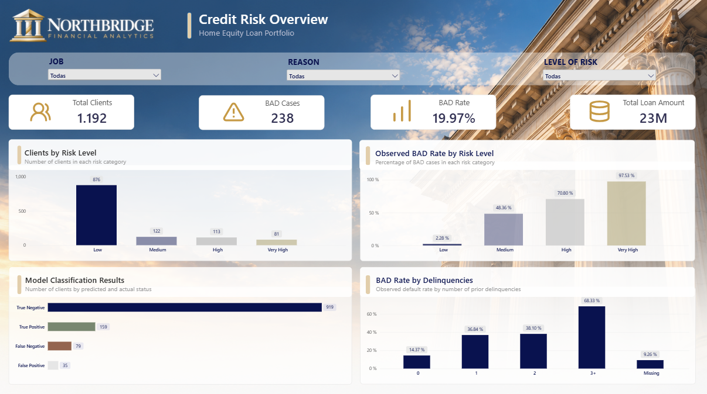
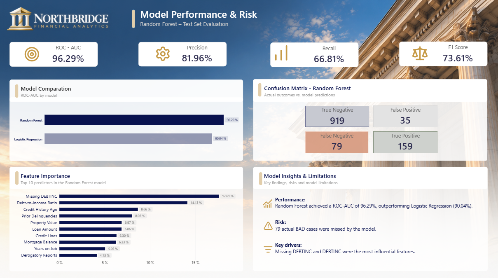

# NORTHBRIDGE | Credit Risk Analytics

### End-to-End Credit Risk Analysis & Machine Learning

An end-to-end data science project analyzing credit risk in a home equity loan portfolio, combining exploratory data analysis, statistical analysis, predictive modeling, and an interactive Power BI dashboard.

## Project Overview

The objective is to identify patterns associated with credit risk and compare machine learning models for classifying borrowers according to their observed loan outcome.

The project uses the public **HMEQ (Home Equity)** dataset, containing 5,960 observations and 13 original variables.

## Project Workflow

1. Data understanding and data quality assessment
2. Exploratory data analysis (EDA)
3. Statistical analysis
4. Data preprocessing and feature engineering
5. Logistic Regression and Random Forest modeling
6. Model evaluation and interpretation
7. Power BI dashboard development

## Machine Learning Results

Models were evaluated on a stratified 20% test split (1,192 observations).

| Metric | Logistic Regression | Random Forest |
|---|---:|---:|
| Accuracy | 88.34% | 90.44% |
| Precision | 76.76% | 81.96% |
| Recall | 59.66% | 66.81% |
| F1-Score | 67.14% | 73.61% |
| ROC-AUC | 90.04% | 96.29% |

Random Forest achieved the strongest results among the two evaluated models.

### Random Forest Confusion Matrix

| | Predicted Non-BAD | Predicted BAD |
|---|---:|---:|
| Actual Non-BAD | 919 | 35 |
| Actual BAD | 79 | 159 |

The model missed 79 actual BAD cases, an important consideration for credit risk applications.

## Power BI Dashboard

The **NORTHBRIDGE Financial Analytics** dashboard contains two complementary pages.

### 1. Credit Risk Overview

Portfolio composition, observed BAD rates, risk segments, classification results, and prior delinquencies.

### 2. Model Performance & Risk

Random Forest evaluation metrics, model comparison, confusion matrix, feature importance, and model limitations.

## Key Findings

- The observed BAD rate in the full HMEQ dataset is approximately 19.95%.
- Missing debt-to-income information is strongly associated with the observed BAD outcome in this dataset.
- Random Forest outperformed Logistic Regression across the reported evaluation metrics.
- Prior delinquencies and debt-to-income information are important risk-related features.

## Tools & Technologies

**Python · pandas · NumPy · scikit-learn · Statistical Analysis · Matplotlib · Seaborn · Power BI · Git · GitHub**

## Limitations

This is an educational portfolio project based on historical HMEQ data. The reported model results are based on a held-out test split, which was also used to compare models. Feature importance does not establish causality, and model scores should not be interpreted as calibrated or regulatory probabilities of default.

## Author

Data Science & Machine Learning Portfolio

[Portfolio Website](https://anabenitez.tech/)